# Tema 3. El modelo relacional

**Módulo:** Bases de Datos 
> Del diagrama conceptual a un esquema formado por relaciones, claves y restricciones.

## ¿Qué aprenderás?

Al terminar este tema podrás:

- Reconocer las tablas, filas, columnas y claves de una base de datos relacional.
- Diferenciar una clave primaria de una clave foránea.
- Transformar las entidades de un modelo entidad/relación (E/R) en tablas.
- Transformar relaciones **1:N**, **N:M** y **1:1**.
- Resolver casos especiales: entidades débiles, relaciones reflexivas, jerarquías y relaciones de grado 3.

---

## 1. Introducción al modelo relacional

Los **sistemas gestores de bases de datos (SGBD)** permiten almacenar, organizar y consultar información. 

Conviene situar este tema dentro del proceso completo:

| Nivel | Pregunta | Resultado orientativo |
|---|---|---|
| Conceptual | ¿Qué conceptos y reglas existen en el dominio? | Modelo E/R |
| Lógico | ¿Cómo se representan en el modelo relacional? | Relaciones, claves y restricciones |
| Físico | ¿Cómo se almacenarán y accederán en un SGBD concreto? | Índices, particiones y parámetros |

Existen diferentes **modelos lógicos** de bases de datos, como el jerárquico, el de red, el relacional y el orientado a objetos.

La mayoría de los SGBD comerciales (Oracle, MySQL,...) actuales están basados en el modelo relacional mientras que los sistemas más antiguos estaban basados en el modelo de red o el modelo jerárquico. Otros modelos basados en objetos, son los utilizados en la actualidad Big Data.

En este tema trabajaremos con el **modelo relacional**, utilizado por sistemas como MySQL, PostgreSQL (que estudiaremos más adelante) y Oracle Database.

El modelo relacional fue propuesto por Edgar F. Codd en 1970. Su idea central consiste en representar los datos mediante **relaciones** y manipularlos mediante operaciones con fundamento matemático.

Su éxito se debe, entre otros motivos, a que:

- utiliza una estructura lógica uniforme;
- separa la representación lógica de muchos detalles físicos;
- dispone de reglas de integridad;
- permite expresar consultas de forma declarativa;
- cuenta con una base formal: teoría de conjuntos y lógica de predicados.

Se basan en el **álgebra relacional** que es un modelo matemático con sólidos fundamentos.

En un lenguaje declarativo indicamos **qué** resultado queremos, no necesariamente el algoritmo exacto para obtenerlo. El SGBD puede estudiar distintas estrategias de ejecución.

La idea principal es sencilla: **la información se organiza en tablas que pueden relacionarse entre sí**.

Por ejemplo, un instituto puede guardar los datos de sus alumnos en una tabla `ALUMNO` y los de sus módulos en otra tabla `MODULO`.

### 1.1. ¿Cómo es una tabla?

Imagina esta tabla `PERSONA`:

| DNI | Nombre | Apellido | Nacimiento | Estado civil |
|---|---|---|---|---|
| 52768987 | Juan | Loza | 15/06/1976 | Soltero |
| 06876983 | Isabel | Gálvez | 23/12/1969 | Casada |
| 34678987 | Micaela | Ruiz | 02/10/1985 | Soltera |

- **Tabla o relación:** conjunto de datos organizados en filas y columnas.
- **Fila, registro o tupla:** información de una persona concreta. Por ejemplo, la fila de Isabel.
- **Columna, campo o atributo:** característica que se guarda. Por ejemplo, `Nombre`.
- **Valor:** dato almacenado en una celda. Por ejemplo, `Loza`.

> **Importante:** el **esquema de una tabla** es su definición (nombre y atributos). Los **datos de la tabla** son las filas que contiene en un momento determinado.

Un esquema puede representarse así:

```text
PERSONA(DNI, Nombre, Apellido, Nacimiento, Sexo, EstadoCivil)
```

<!-- Imagen opcional: esquema de la entidad/tabla PERSONA del material original. -->
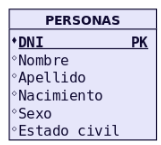

---

## 2. Elementos y propiedades del modelo relacional

### 2.1. Propiedades de las tablas

En el modelo relacional:

- Cada tabla tiene un nombre que la identifica.
- Dentro de una tabla, cada columna tiene un nombre diferente.
- Las filas representan registros distintos; no hay dos tuplas idénticas.
- El orden de las filas no cambia su significado.
- El orden de las columnas tampoco cambia su significado.
- Cada columna contiene valores compatibles con el tipo de dato o **dominio** definido para ella.

### 2.2. Dominio

El **dominio** es el conjunto de valores permitidos para un atributo.

Por ejemplo:

| Atributo | Valores esperados |
|---|---|
| `edad` | Números enteros no negativos dentro de un rango válido |
| `fecha_nacimiento` | Fechas válidas |
| `correo` | Direcciones de correo electrónico válidas |
| `estado_matricula` | `activa`, `anulada`, `finalizada`... |

### 2.3. Claves

Las **claves** permiten identificar registros y conectar tablas.

| Tipo de clave | ¿Qué significa? |
|---|---|
| **Clave candidata** | Atributo o conjunto mínimo de atributos que puede identificar cada fila de manera única. |
| **Clave primaria (PK)** | Clave candidata elegida para identificar cada fila de una tabla. |
| **Clave alternativa** | Clave candidata que no se ha elegido como primaria. |
| **Clave foránea (FK)** | Atributo o conjunto de atributos que hace referencia a una clave de otra tabla (o de la misma tabla). |

#### Ejemplo de clave primaria

| id_alumno (PK) | nombre | correo |
|---|---|---|
| 1 | Ana | ana@ejemplo.com |
| 2 | Pedro | pedro@ejemplo.com |
| 3 | Laura | laura@ejemplo.com |

La columna `id_alumno` es la **clave primaria**, porque identifica a cada alumno. No puede repetirse ni contener `NULL`.

Si el correo también debe ser único y obligatorio, puede ser una **clave candidata**; si no lo elegimos como PK, será una **clave alternativa**.

#### Ejemplo de clave foránea

**PROFESOR**

| id_profesor (PK) | nombre |
|---|---|
| 10 | Marta |
| 20 | Carlos |

**ALUMNO**

| id_alumno (PK) | nombre | id_profesor (FK) |
|---|---|---|
| 1 | Ana | 10 |
| 2 | Pedro | 10 |
| 3 | Laura | 20 |

La clave foránea `id_profesor` indica qué profesor tiene asignado cada alumno:

- Ana y Pedro tienen como profesor a Marta (`10`).
- Laura tiene como profesor a Carlos (`20`).

La FK debe apuntar a un profesor que exista, salvo que se permita dejarla vacía (`NULL`) porque el alumno todavía no tenga profesor asignado.

### 2.4. Integridad de los datos

Las reglas de integridad ayudan a evitar información incorrecta:

- **Integridad de entidad:** la clave primaria es única y no admite `NULL`.
- **Integridad referencial:** una clave foránea con valor debe hacer referencia a un registro existente en la tabla correspondiente.
- **Integridad de dominio:** los valores almacenados deben respetar las condiciones de cada atributo.

---

## 3. Del modelo E/R al modelo relacional

El **modelo entidad/relación (E/R)** representa gráficamente las entidades, sus atributos y las relaciones que existen entre ellas.

Al transformarlo al **modelo relacional**, obtenemos tablas con sus claves primarias y foráneas.

Las reglas básicas son:

1. Cada **entidad** se transforma en una **tabla**.
2. Cada **atributo simple** se transforma en una **columna**.
3. El **identificador** de la entidad pasa a ser su **clave primaria (PK)**.
4. Las **relaciones** se representan mediante claves foráneas o tablas intermedias, según su cardinalidad.

<!-- Imagen opcional: diagrama E/R general del material original. -->
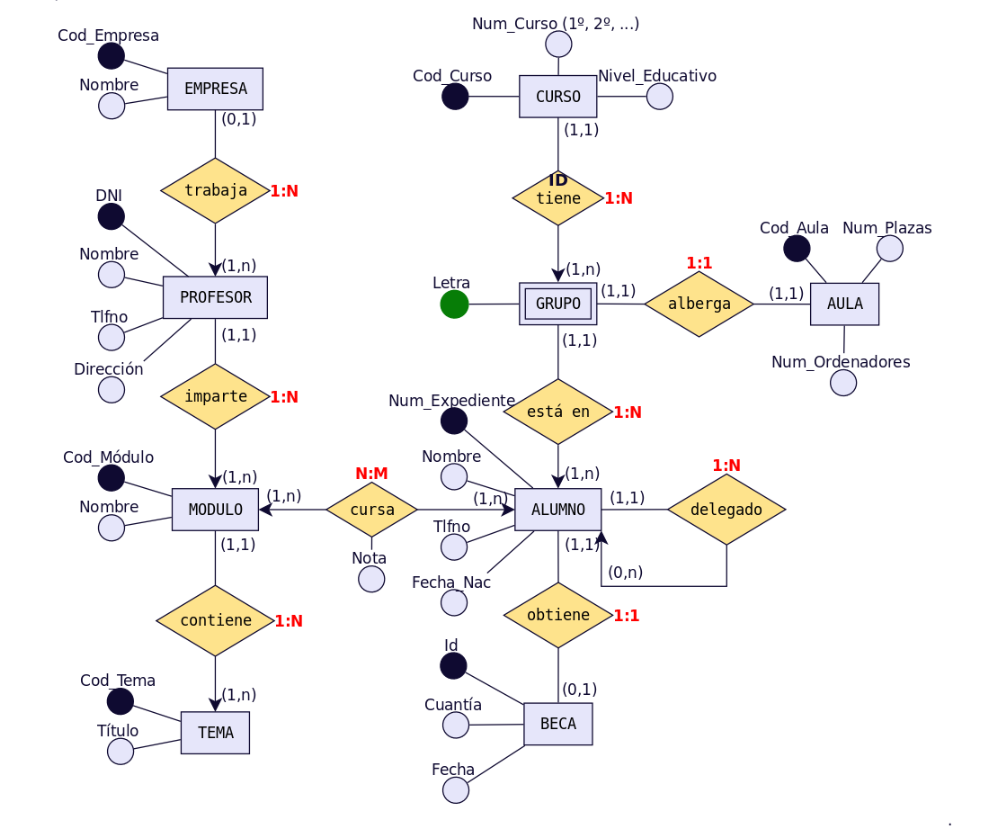

### 3.1. Transformación de entidades

Supongamos que tenemos la entidad `AULA` con estos atributos:

- `Cod_Aula` (identificador).
- `Num_Plazas`.
- `Num_Ordenadores`.

Al pasar al modelo relacional obtenemos:

```text
AULA(
    Cod_Aula PK,
    Num_Plazas,
    Num_Ordenadores
)
```

<!-- Imagen original de la tabla AULA. -->
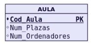

**Resultado:** una tabla llamada `AULA`, con tres columnas y `Cod_Aula` como clave primaria.

---

## 4. Transformación de relaciones binarias

Una **relación binaria** conecta dos entidades. Para transformarla debemos fijarnos en su cardinalidad: **1:N, N:M o 1:1**.

### 4.1. Relaciones 1:N (uno a muchos)

**Regla habitual:** la clave primaria de la entidad del lado **1** se añade como **clave foránea** en la tabla del lado **N**.

#### Ejemplo: MÓDULO y TEMA

Un módulo puede tener muchos temas, pero cada tema pertenece a un único módulo.

**Antes de transformar:**

```text
MÓDULO (1) ─── (N) TEMA
```

**Después de transformar:**

```text
MODULO(
    Cod_Modulo PK,
    Nombre
)

TEMA(
    Cod_Tema PK,
    Titulo,
    Cod_Modulo FK
)
```

<!-- Imagen original: MÓDULO–TEMA, caso 2 de las relaciones 1:N. -->
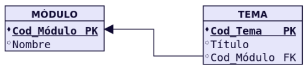

Por ejemplo:

**MODULO**

| Cod_Modulo (PK) | Nombre |
|---|---|
| 1 | Bases de Datos |
| 2 | Programación |

**TEMA**

| Cod_Tema (PK) | Titulo | Cod_Modulo (FK) |
|---|---|---|
| 101 | Modelo E/R | 1 |
| 102 | Modelo relacional | 1 |
| 201 | Variables | 2 |

Fíjate en que el valor `1` aparece varias veces en `TEMA`: eso es correcto, porque **un módulo puede tener varios temas**.

> **Recuerda:** **1:N → la FK va en el lado N**.

#### ¿Qué ocurre si una participación es opcional?


### ¿Qué ocurre si una participación es opcional?

En una relación **1:N**, lo habitual es incorporar la clave primaria (PK) de la entidad del lado **1** como clave foránea (FK) en la entidad del lado **N**.

Sin embargo, cuando la participación es opcional, también podemos utilizar una **tabla intermedia** para representar la relación.

#### Ejemplo: relación entre EMPRESA y PROFESOR

En el diagrama se representa una relación en la que:

- Una **empresa** puede tener varios profesores trabajando en ella.
- Un **profesor** puede trabajar en una empresa o no trabajar en ninguna.

En este caso, se ha decidido crear una tabla intermedia llamada **TRABAJA**, que contiene:

| Atributo | Tipo de clave | Descripción |
|---|---|---|
| `DNI` | PK y FK | Identifica al profesor y hace referencia a la tabla PROFESOR. |
| `Cod_Empresa` | FK | Identifica la empresa y hace referencia a la tabla EMPRESA. |

La clave primaria de TRABAJA es `DNI`, porque cada profesor puede aparecer **como máximo una vez** en esta relación.

#### ¿Qué ocurre si un profesor no trabaja en ninguna empresa?

Simplemente, ese profesor **no tendrá ningún registro en la tabla TRABAJA**.

De esta manera, no necesitamos introducir valores `NULL` para indicar que todavía no tiene una empresa asignada.

<!-- Imagen original: PROFESOR–EMPRESA, ejemplo de 1:N con tabla de relación. Se muestra como alternativa de diseño, no como regla obligatoria. -->
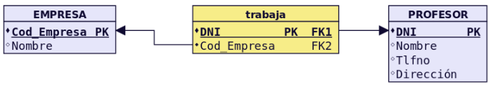

#### ¿Es obligatorio crear una tabla intermedia?

**No.** También podríamos añadir `Cod_Empresa` directamente a la tabla PROFESOR como clave foránea.

En ese caso:

- Si el profesor trabaja en una empresa, `Cod_Empresa` contendrá el código de esa empresa.
- Si el profesor no trabaja en ninguna empresa, `Cod_Empresa` tendrá el valor `NULL`.

Ambas soluciones son válidas. La elección dependerá de las necesidades de la base de datos.

> **Recuerda:** una participación opcional no obliga a crear una tabla intermedia. En muchas relaciones **1:N** basta con colocar una clave foránea que admita valores `NULL`.

### 4.2. Relaciones N:M (muchos a muchos)

**Regla:** se crea una **tabla intermedia** que contiene las claves de ambas entidades como claves foráneas.

Habitualmente, la combinación de esas dos claves forma una **clave primaria compuesta**.

#### Ejemplo: ALUMNO y MÓDULO

- Un alumno puede cursar varios módulos.
- Un módulo puede ser cursado por varios alumnos.

**Antes:**

```text
ALUMNO (N) ─── (M) MÓDULO
```

**Después:**

```text
ALUMNO(
    Num_Expediente PK,
    Nombre
)

MODULO(
    Cod_Modulo PK,
    Nombre
)

CURSA(
    Num_Expediente PK, FK,
    Cod_Modulo PK, FK
)
```

<!-- Imagen original: ALUMNO–CURSA–MÓDULO. -->
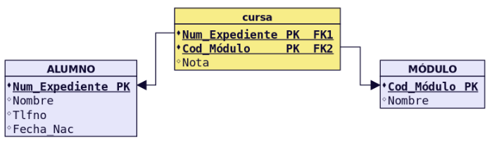

**CURSA**

| Num_Expediente (PK, FK) | Cod_Modulo (PK, FK) |
|---|---|
| 101 | 1 |
| 101 | 2 |
| 102 | 1 |

El alumno `101` cursa dos módulos. El módulo `1` lo cursan dos alumnos.

Las dos columnas de `CURSA` forman **una única clave primaria compuesta**, no dos claves primarias independientes.

Si la relación tuviera un atributo propio, como `Fecha_Matricula`, se añadiría a `CURSA`.

> **Recuerda:** **N:M → nueva tabla con dos FKs**.

### 4.3. Relaciones 1:1 (uno a uno)

En una relación **1:1**, cada registro de una entidad puede relacionarse como máximo con uno de la otra entidad, y viceversa.

**Regla habitual:** se incorpora una clave foránea en una de las tablas y se impide que su valor se repita mediante una restricción `UNIQUE` (o se utiliza como PK compartida).

#### Ejemplo: ALUMNO y BECA

Imaginemos que cada beca corresponde a un único alumno y que cada alumno puede tener, como máximo, una beca.

```text
ALUMNO(
    Num_Expediente PK,
    Nombre
)

BECA(
    Id_Beca PK,
    Cuantia,
    Num_Expediente FK, UNIQUE
)
```

<!-- Imagen original: ALUMNO–BECA. -->
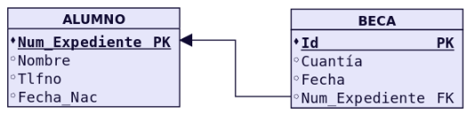

Con `UNIQUE` en `BECA.Num_Expediente`, dos becas no pueden apuntar al mismo alumno. Si toda beca debe pertenecer a un alumno, esa FK también será `NOT NULL`.

En una relación 1:1 también puede optarse por una tabla intermedia o por unir ambas entidades en una sola tabla, cuando tenga sentido según los requisitos.

**Importante:** la participación opcional no obliga por sí misma a crear una tercera tabla. La elección debe reflejar correctamente los datos que se quieren guardar.

<!-- Imagen original: relación 1:1 con tabla intermedia (HOMBRE–MUJER). -->
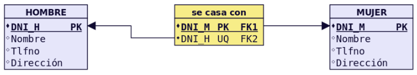

### 4.4. Resumen de relaciones binarias

| Relación | Transformación habitual | Regla para recordar |
|---|---|---|
| **1:N** | Añadir la PK del lado 1 como FK en el lado N. | FK en el lado N. |
| **N:M** | Crear una tabla intermedia con dos FKs. | Nueva tabla. |
| **1:1** | Añadir una FK con `UNIQUE` en una de las tablas. | FK única, según el caso. |

---

## 5. Entidades débiles y relaciones de dependencia

Una **entidad débil** depende de otra entidad para existir, para identificarse o para ambas cosas.

### 5.1. Dependencia en existencia

Una entidad depende de otra para poder existir, pero puede tener su propio identificador.

Por ejemplo, una **RESERVA** pertenece a un **CLIENTE**:

```text
CLIENTE(Id_Cliente PK, Nombre)
RESERVA(Id_Reserva PK, Fecha, Id_Cliente FK)
```

El hecho de depender de un cliente no significa que siempre deba borrarse automáticamente la reserva al borrar el cliente. La acción de borrado depende de las reglas del sistema.

### 5.2. Dependencia en identificación

La entidad débil necesita la clave de la entidad fuerte para identificarse.

#### Ejemplo: CURSO y GRUPO

Imaginemos que dentro de un curso existen grupos `A`, `B`, etc. El nombre del grupo puede repetirse en distintos cursos.

```text
CURSO(
    Cod_Curso PK,
    Nombre
)

GRUPO(
    Cod_Curso PK, FK,
    Letra_Grupo PK,
    Turno
)
```

La clave primaria de `GRUPO` está formada por **(Cod_Curso, Letra_Grupo)**. Así, el grupo `A` puede existir en varios cursos sin confundirse.

<!-- Imagen original: relación débil en identificación entre CURSO y GRUPO. -->
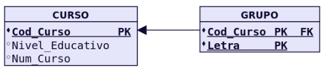

---

## 6. Relaciones reflexivas o recursivas

Una **relación reflexiva** aparece cuando una entidad se relaciona consigo misma.

#### Ejemplo: ALUMNO y alumno delegado

Un alumno puede tener asignado como delegado a otro alumno.

```text
ALUMNO(
    Num_Expediente PK,
    Nombre,
    Num_Exp_Delegado FK
)
```

`Num_Exp_Delegado` hace referencia a `ALUMNO.Num_Expediente`.

<!-- Imagen original: relación reflexiva de ALUMNO. -->
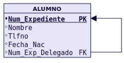

La transformación depende de la cardinalidad:

- **Reflexiva 1:N:** normalmente se añade una FK a la misma tabla.
- **Reflexiva N:M:** se crea una tabla intermedia con dos FKs que apuntan a la misma entidad, diferenciando sus funciones.
- **Reflexiva 1:1:** puede utilizarse una FK a la propia tabla con `UNIQUE`, junto con las restricciones necesarias.

> Cuando una FK apunta a su propia tabla, debe tener un nombre que explique su función, como `Id_Supervisor` o `Num_Exp_Delegado`.

---

## 7. Jerarquías: supertipos y subtipos

Una **jerarquía** aparece cuando varias entidades comparten características generales, pero tienen también características específicas.

Por ejemplo:

- Todas las personas tienen identificador y nombre.
- Los alumnos tienen número de expediente.
- Los profesores tienen especialidad.

Una forma habitual de transformarlo consiste en crear una tabla para el **supertipo** (`PERSONA`) y otra para cada **subtipo** (`ALUMNO` y `PROFESOR`).

```text
PERSONA(
    Id_Persona PK,
    Nombre
)

ALUMNO(
    Id_Persona PK, FK,
    Num_Expediente
)

PROFESOR(
    Id_Persona PK, FK,
    Especialidad
)
```

La clave `Id_Persona` de cada subtipo es a la vez **PK y FK**.

<!-- Imagen original: jerarquía del material y su transformación a tablas. -->
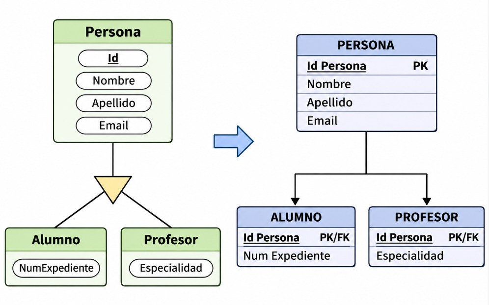

Según las características de la jerarquía, también pueden utilizarse otras estrategias, como una sola tabla para todos los tipos. No existe una solución única para todos los casos.

---

## 8. Relaciones de grado 3 (ternarias)

Una **relación ternaria** conecta tres entidades al mismo tiempo.

Siempre que sea posible se recomienda convertir las relaciones de grado 3 en dos relaciones de grado 2.

Las relaciones de grado 3 pueden generar una nueva tabla dependiendo de la cardinalidad de la relación.

#### Ejemplo: ALUMNO, ASIGNATURA y CURSO_ESCOLAR

Queremos guardar qué alumno se matricula en qué asignatura durante qué curso escolar.

Una posible transformación es:

```text
ALUMNO(Id_Alumno PK, Nombre)
ASIGNATURA(Id_Asignatura PK, Nombre)
CURSO_ESCOLAR(Id_Curso PK, Anio)

MATRICULA(
    Id_Alumno PK, FK,
    Id_Asignatura PK, FK,
    Id_Curso PK, FK
)
```

<!-- Imagen original: relación de grado 3 del material. -->
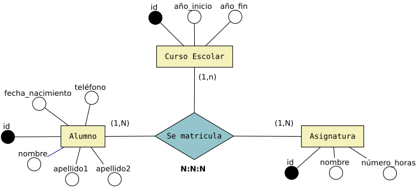

La tabla `MATRICULA` guarda cada combinación completa de **alumno + asignatura + curso escolar**.

En el ejemplo, las tres FKs forman la PK. En otros problemas, las reglas de cardinalidad pueden permitir otra clave.

<!-- Imagen original: relación de grado 3 del material. -->
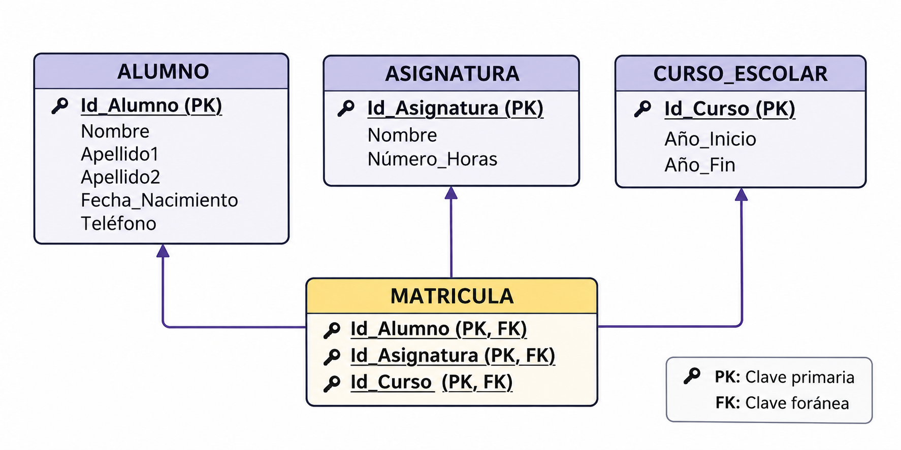

### Cardinalidad 1:N:N
En este caso creamos una tabla. **La clave primaria de la nueva tabla estará formada por las dos claves de las entidades que participan como N en la relación.**

### Cardinalidad 1:1:N
En este caso **NO** es necesario crear una tabla. La entidad que participa como N recibe las claves de las dos entidades que participan como 1.

> **Importante:** una relación ternaria no debe sustituirse automáticamente por varias relaciones binarias: podríamos perder el significado de la combinación de las tres entidades.

---

## 9. Método paso a paso para transformar un modelo E/R

Ante cualquier ejercicio, sigue este orden:

1. **Localiza las entidades** del diagrama.
2. **Crea una tabla por cada entidad** e incluye sus atributos.
3. **Marca la clave primaria (PK)** de cada tabla.
4. **Busca las relaciones 1:N** y coloca las FKs en el lado N.
5. **Busca las relaciones N:M** y crea las tablas intermedias correspondientes.
6. **Revisa las relaciones 1:1** y decide dónde colocar una FK única.
7. **Comprueba los casos especiales**: entidades débiles, reflexivas, jerarquías y ternarias.
8. **Revisa los resultados:** ninguna FK debe hacer referencia a un registro inexistente; determina cuáles pueden admitir `NULL` y qué valores deben ser únicos.

<!-- Imagen opcional: resumen gráfico de transformaciones N:M, 1:N, 1:1 y reflexivas. -->
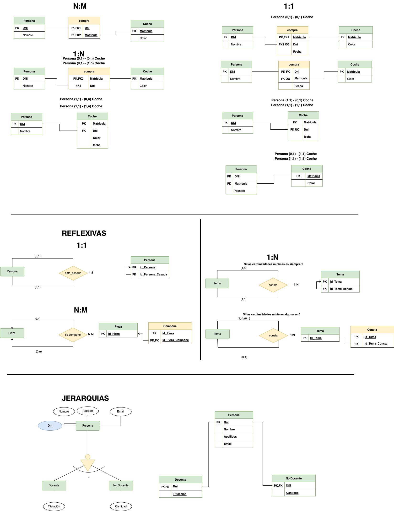

### Resumen rápido

| Si ves... | Piensa en... |
|---|---|
| Entidad | Una tabla |
| Atributo simple | Una columna |
| Identificador | Clave primaria (PK) |
| Relación 1:N | FK en el lado N |
| Relación N:M | Tabla intermedia |
| Relación 1:1 | FK con `UNIQUE`, según el caso |
| Entidad débil en identificación | PK compuesta que incluye la FK de la entidad fuerte |
| Relación reflexiva 1:N | FK que apunta a la propia tabla |
| Relación ternaria | Normalmente una tabla con tres FKs |

---

## 10. Actividad guiada: base de datos de un instituto

Un instituto quiere almacenar información sobre **profesores, alumnos y módulos**:

- Cada profesor tiene un identificador, nombre y especialidad.
- Cada alumno tiene un número de expediente, nombre y correo.
- Cada módulo tiene un código, nombre y número de horas.
- Un profesor puede tutorizar a varios alumnos, pero cada alumno tiene un único tutor.
- Un alumno puede cursar varios módulos y un módulo puede tener varios alumnos.

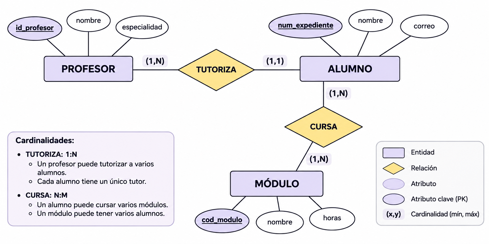

### Paso 1. Identifica las entidades

Las entidades son `PROFESOR`, `ALUMNO` y `MODULO`.

### Paso 2. Transforma las entidades en tablas

```text
PROFESOR(Id_Profesor PK, Nombre, Especialidad)
ALUMNO(Num_Expediente PK, Nombre, Correo)
MODULO(Cod_Modulo PK, Nombre, Horas)
```

### Paso 3. Transforma la relación 1:N

Como un profesor tutoriza a varios alumnos, la clave de `PROFESOR` pasa a `ALUMNO` como FK:

```text
ALUMNO(Num_Expediente PK, Nombre, Correo, Id_Profesor FK)
```

### Paso 4. Transforma la relación N:M

Como varios alumnos cursan varios módulos, creamos una tabla `CURSA`:

```text
CURSA(Num_Expediente PK, FK, Cod_Modulo PK, FK)
```

### Resultado final

```text
PROFESOR(Id_Profesor PK, Nombre, Especialidad)
ALUMNO(Num_Expediente PK, Nombre, Correo, Id_Profesor FK)
MODULO(Cod_Modulo PK, Nombre, Horas)
CURSA(Num_Expediente PK, FK, Cod_Modulo PK, FK)
```
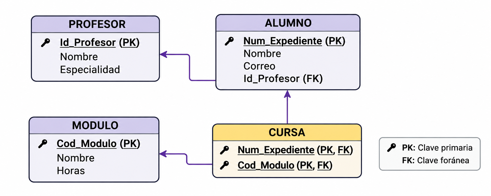

**Comprobación:** partimos de tres entidades y obtenemos cuatro tablas. La tabla adicional `CURSA` se crea para representar la relación N:M.

### Preguntas de repaso

1. ¿Por qué `Id_Profesor` se añade a la tabla `ALUMNO`?
2. ¿Por qué la relación `CURSA` necesita una tabla nueva?
3. ¿Qué atributos forman la clave primaria de `CURSA`?
4. ¿Podría haber varios alumnos con el mismo `Id_Profesor`? ¿Por qué?
5. ¿Qué ocurriría si intentásemos insertar en `CURSA` un módulo que no existe?

---

## 11. Errores habituales

- **Confundir PK con FK:** la PK identifica registros propios; la FK referencia registros de otra tabla o de la misma.
- **Creer que una tabla intermedia tiene dos PK:** normalmente tiene **una PK compuesta por dos columnas**.
- **Colocar la FK en el lado 1 de una relación 1:N:** lo habitual es colocarla en el lado N.
- **Olvidar `UNIQUE` en una relación 1:1:** una FK por sí sola no impide que varias filas hagan referencia al mismo registro.
- **Pensar que toda FK debe ser obligatoria:** puede admitir `NULL` cuando el vínculo sea opcional.
- **Convertir cualquier relación ternaria en binarias:** puede cambiar el significado de los datos.

> **Idea clave del tema:** transformar un modelo E/R consiste en representar las entidades y sus relaciones mediante tablas, claves primarias y claves foráneas, manteniendo las reglas de los datos que queremos almacenar.
