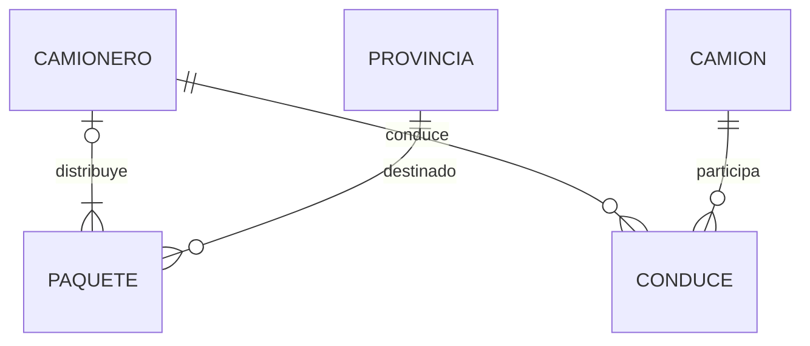
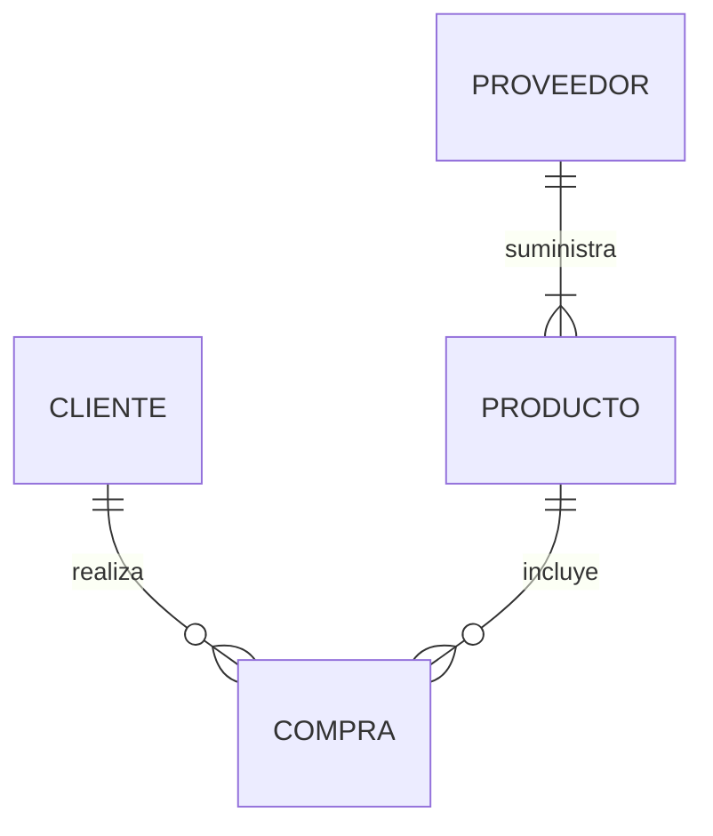
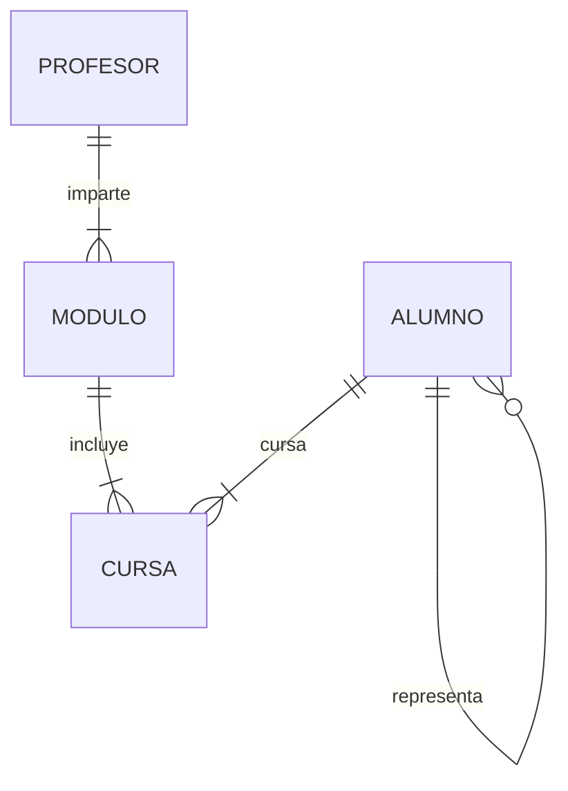
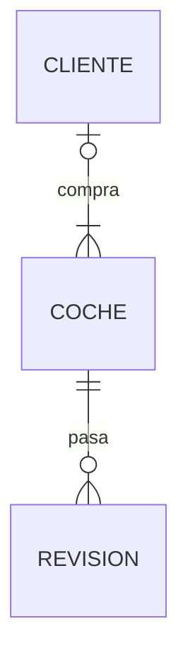
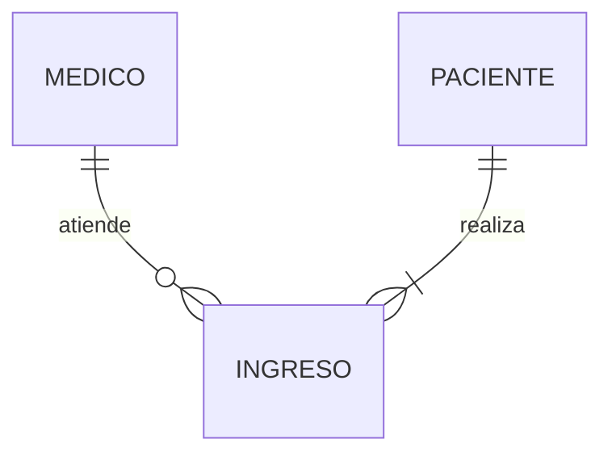
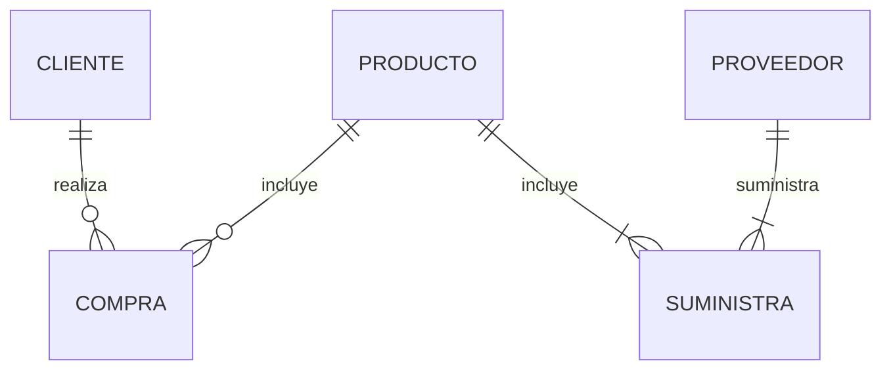

# Solucionario: transformación del modelo E/R al modelo relacional

## Notación

- **PK**: clave primaria.
- **FK**: clave foránea.
- **NOT NULL**: valor obligatorio.
- **NULL**: valor opcional.
- **UNIQUE**: valor o combinación de valores únicos.

Las cardinalidades se interpretan según la notación de los diagramas originales. Una clave primaria compuesta está formada por varios atributos.

---

## Ejercicio 1. Empresa de transportes

### 1. Localizar las entidades

CAMIONERO, CAMION, PAQUETE y PROVINCIA.

### 2 y 3. Crear las tablas y marcar las PK

| Tabla | Atributos |
|---|---|
| CAMIONERO | **dni (PK)**, nombre, poblacion, tfno, direccion, salario |
| CAMION | **matricula (PK)**, potencia, modelo, tipo |
| PAQUETE | **codigo (PK)**, descripcion, destinatario, direccion |
| PROVINCIA | **codigo (PK)**, nombre |

### 4. Relaciones 1:N

- **DISTRIBUYE:** un camionero distribuye uno o varios paquetes. Un paquete puede tener cero o un camionero. Se añade `dni_camionero` a PAQUETE como FK, que admite NULL.
- **DESTINADO:** una provincia recibe cero o varios paquetes. Cada paquete tiene una única provincia de destino. Se añade `codigo_provincia` a PAQUETE como FK obligatoria.

### 5. Relaciones N:M

**CONDUCE:** un camionero puede conducir varios camiones y un camión puede ser conducido por varios camioneros. Se crea CONDUCE con las dos FKs, que forman su PK compuesta.

### 6. Relaciones 1:1

No existen.

### 7. Casos especiales

No existen entidades débiles, relaciones reflexivas, jerarquías ni ternarias.

### 8. Modelo relacional y restricciones

```text
CAMIONERO(dni, nombre, poblacion, tfno, direccion, salario)
    PK: dni

CAMION(matricula, potencia, modelo, tipo)
    PK: matricula

PROVINCIA(codigo, nombre)
    PK: codigo

PAQUETE(codigo, descripcion, destinatario, direccion,
        dni_camionero, codigo_provincia)
    PK: codigo
    FK: dni_camionero -> CAMIONERO(dni)
    FK: codigo_provincia -> PROVINCIA(codigo)

CONDUCE(dni_camionero, matricula_camion)
    PK: (dni_camionero, matricula_camion)
    FK: dni_camionero -> CAMIONERO(dni)
    FK: matricula_camion -> CAMION(matricula)
```

| Atributo | Restricción |
|---|---|
| PAQUETE.dni_camionero | NULL |
| PAQUETE.codigo_provincia | NOT NULL |
| CONDUCE.dni_camionero | NOT NULL |
| CONDUCE.matricula_camion | NOT NULL |
| Pareja de claves de CONDUCE | Única |



---

## Ejercicio 2. Clientes, productos y proveedores

### 1. Localizar las entidades

CLIENTE, PRODUCTO y PROVEEDOR.

### 2 y 3. Crear las tablas y marcar las PK

| Tabla | Atributos |
|---|---|
| CLIENTE | **dni (PK)**, nombre, apellidos, fecha_nac, tfno |
| PRODUCTO | **codigo (PK)**, nombre, precio |
| PROVEEDOR | **nif (PK)**, nombre, direccion |

### 4. Relaciones 1:N

**SUMINISTRA:** un proveedor suministra uno o varios productos y cada producto tiene un único proveedor. Se añade `nif_proveedor` a PRODUCTO como FK obligatoria.

### 5. Relaciones N:M

**COMPRA:** un cliente puede comprar cero o varios productos y un producto puede ser comprado por cero o varios clientes. Se crea COMPRA con las dos FKs como PK compuesta. La relación no tiene atributos propios.

### 6. Relaciones 1:1

No existen.

### 7. Casos especiales

No existen.

### 8. Modelo relacional y restricciones

```text
CLIENTE(dni, nombre, apellidos, fecha_nac, tfno)
    PK: dni

PROVEEDOR(nif, nombre, direccion)
    PK: nif

PRODUCTO(codigo, nombre, precio, nif_proveedor)
    PK: codigo
    FK: nif_proveedor -> PROVEEDOR(nif)

COMPRA(dni_cliente, codigo_producto)
    PK: (dni_cliente, codigo_producto)
    FK: dni_cliente -> CLIENTE(dni)
    FK: codigo_producto -> PRODUCTO(codigo)
```

| Atributo | Restricción |
|---|---|
| PRODUCTO.nif_proveedor | NOT NULL |
| COMPRA.dni_cliente | NOT NULL |
| COMPRA.codigo_producto | NOT NULL |
| Pareja de claves de COMPRA | Única |

Una pareja cliente-producto solo puede registrarse una vez; el modelo no contempla un historial de compras.



---

## Ejercicio 3. Centro educativo

### 1. Localizar las entidades

PROFESOR, ALUMNO y MODULO.

### 2 y 3. Crear las tablas y marcar las PK

| Tabla | Atributos |
|---|---|
| PROFESOR | **dni (PK)**, nombre, direccion, tfno |
| ALUMNO | **expediente (PK)**, nombre, apellidos, fecha_nac |
| MODULO | **codigo (PK)**, nombre |

### 4. Relaciones 1:N

**IMPARTE:** un profesor imparte uno o varios módulos y cada módulo es impartido por un único profesor. Se añade `dni_profesor` a MODULO como FK obligatoria.

### 5. Relaciones N:M

**CURSA:** cada alumno cursa uno o varios módulos y cada módulo es cursado por uno o varios alumnos. Se crea CURSA con `expediente_alumno` y `codigo_modulo` como FKs y PK compuesta.

### 6. Relaciones 1:1

No existen.

### 7. Casos especiales

**ES DELEGADO:** relación reflexiva 1:N. Un alumno puede ser delegado de cero o varios alumnos y cada alumno tiene un delegado. Se añade `expediente_delegado` a ALUMNO como FK que referencia a la propia tabla. No admite NULL según la cardinalidad indicada, ni debe ser UNIQUE, pues varios alumnos pueden compartir delegado. Si se permite que el delegado se represente a sí mismo, la FK puede apuntar al propio registro.

### 8. Modelo relacional y restricciones

```text
PROFESOR(dni, nombre, direccion, tfno)
    PK: dni

ALUMNO(expediente, nombre, apellidos, fecha_nac, expediente_delegado)
    PK: expediente
    FK: expediente_delegado -> ALUMNO(expediente)

MODULO(codigo, nombre, dni_profesor)
    PK: codigo
    FK: dni_profesor -> PROFESOR(dni)

CURSA(expediente_alumno, codigo_modulo)
    PK: (expediente_alumno, codigo_modulo)
    FK: expediente_alumno -> ALUMNO(expediente)
    FK: codigo_modulo -> MODULO(codigo)
```

| Atributo | Restricción |
|---|---|
| ALUMNO.expediente_delegado | NOT NULL |
| MODULO.dni_profesor | NOT NULL |
| CURSA.expediente_alumno | NOT NULL |
| CURSA.codigo_modulo | NOT NULL |
| Pareja de claves de CURSA | Única |

Si se quisiera permitir alumnos sin delegado, habría que modificar la cardinalidad y admitir NULL.



---

## Ejercicio 4. Concesionario de coches

### 1. Localizar las entidades

CLIENTE, COCHE y REVISION.

### 2 y 3. Crear las tablas y marcar las PK

| Tabla | Atributos |
|---|---|
| CLIENTE | **nif (PK)**, nombre, direccion, ciudad, tfno |
| COCHE | **matricula (PK)**, marca, modelo, color, precio |
| REVISION | **codigo (PK)**, filtro, aceite, frenos |

### 4. Relaciones 1:N

- **COMPRA:** un cliente compra uno o varios coches. Un coche puede tener cero o un comprador. Se añade `nif_cliente` a COCHE como FK que admite NULL.
- **PASA:** un coche puede pasar cero o varias revisiones y cada revisión corresponde a un único coche. Se añade `matricula_coche` a REVISION como FK obligatoria.

### 5. Relaciones N:M

No existen.

### 6. Relaciones 1:1

No existen.

### 7. Casos especiales

No existen. REVISION no es una entidad débil, pues dispone de su propia PK.

### 8. Modelo relacional y restricciones

```text
CLIENTE(nif, nombre, direccion, ciudad, tfno)
    PK: nif

COCHE(matricula, marca, modelo, color, precio, nif_cliente)
    PK: matricula
    FK: nif_cliente -> CLIENTE(nif)

REVISION(codigo, filtro, aceite, frenos, matricula_coche)
    PK: codigo
    FK: matricula_coche -> COCHE(matricula)
```

| Atributo | Restricción |
|---|---|
| COCHE.nif_cliente | NULL |
| REVISION.matricula_coche | NOT NULL |

Ninguna FK debe ser UNIQUE, puesto que un cliente puede comprar varios coches y un coche puede pasar varias revisiones.



---

## Ejercicio 5. Hospital

### 1. Localizar las entidades

MEDICO, INGRESO y PACIENTE.

### 2 y 3. Crear las tablas y marcar las PK

| Tabla | Atributos |
|---|---|
| MEDICO | **codigo (PK)**, nombre, apellidos |
| INGRESO | **codigo (PK)**, habitacion |
| PACIENTE | **codigo (PK)**, nombre, apellidos |

### 4. Relaciones 1:N

- **ATIENDE:** un médico atiende cero o varios ingresos y cada ingreso es atendido por un único médico. Se añade `codigo_medico` a INGRESO como FK obligatoria.
- **REALIZA:** un paciente realiza uno o varios ingresos y cada ingreso corresponde a un único paciente. Se añade `codigo_paciente` a INGRESO como FK obligatoria. El atributo `fecha` se incorpora también a INGRESO, la tabla del lado N.

### 5. Relaciones N:M

No existen.

### 6. Relaciones 1:1

No existen.

### 7. Casos especiales

No existen. INGRESO tiene una PK propia y no es una entidad débil.

### 8. Modelo relacional y restricciones

```text
MEDICO(codigo, nombre, apellidos)
    PK: codigo

PACIENTE(codigo, nombre, apellidos)
    PK: codigo

INGRESO(codigo, habitacion, fecha, codigo_medico, codigo_paciente)
    PK: codigo
    FK: codigo_medico -> MEDICO(codigo)
    FK: codigo_paciente -> PACIENTE(codigo)
```

| Atributo | Restricción |
|---|---|
| INGRESO.codigo_medico | NOT NULL |
| INGRESO.codigo_paciente | NOT NULL |
| INGRESO.fecha | NOT NULL, si se exige registrar la fecha |

Ambas FKs pueden repetirse: un médico puede atender varios ingresos y un paciente puede ingresar varias veces.



---

## Ejercicio 6. Gestión comercial

### 1. Localizar las entidades

PRODUCTO, CLIENTE y PROVEEDOR.

### 2 y 3. Crear las tablas y marcar las PK

| Tabla | Atributos |
|---|---|
| PRODUCTO | **codigo (PK)**, descripcion, existencias, precio |
| CLIENTE | **codigo (PK)**, nombre, apellidos, direccion, tfno |
| PROVEEDOR | **codigo (PK)**, nombre, apellidos, direccion, tfno |

### 4. Relaciones 1:N

No existen.

### 5. Relaciones N:M

- **COMPRA:** un cliente compra cero o varios productos y un producto puede ser comprado por cero o varios clientes. Se crea COMPRA con `codigo_cliente`, `codigo_producto` y `fecha_compra`, atributo propio de la relación. La PK de la transformación directa es la pareja de FKs.
- **SUMINISTRA:** un proveedor suministra uno o varios productos y un producto es suministrado por uno o varios proveedores. Se crea SUMINISTRA con las dos FKs como PK compuesta.

### 6. Relaciones 1:1

No existen.

### 7. Casos especiales

No existen entidades débiles, relaciones reflexivas, jerarquías ni ternarias. Hay que conservar el atributo propio de COMPRA.

### 8. Modelo relacional y restricciones

```text
PRODUCTO(codigo, descripcion, existencias, precio)
    PK: codigo

CLIENTE(codigo, nombre, apellidos, direccion, tfno)
    PK: codigo

PROVEEDOR(codigo, nombre, apellidos, direccion, tfno)
    PK: codigo

COMPRA(codigo_cliente, codigo_producto, fecha_compra)
    PK: (codigo_cliente, codigo_producto)
    FK: codigo_cliente -> CLIENTE(codigo)
    FK: codigo_producto -> PRODUCTO(codigo)

SUMINISTRA(codigo_proveedor, codigo_producto)
    PK: (codigo_proveedor, codigo_producto)
    FK: codigo_proveedor -> PROVEEDOR(codigo)
    FK: codigo_producto -> PRODUCTO(codigo)
```

| Atributo | Restricción |
|---|---|
| COMPRA.codigo_cliente | NOT NULL |
| COMPRA.codigo_producto | NOT NULL |
| COMPRA.fecha_compra | NOT NULL, si se exige registrar la fecha |
| SUMINISTRA.codigo_proveedor | NOT NULL |
| SUMINISTRA.codigo_producto | NOT NULL |
| Pareja de claves de COMPRA | Única |
| Pareja de claves de SUMINISTRA | Única |



### Consideración adicional: compras repetidas

La transformación directa no permite que un cliente compre el mismo producto en fechas diferentes.

| codigo_cliente | codigo_producto | fecha_compra |
|---|---|---|
| C01 | P01 | 20/11/2026 |
| C01 | P01 | 25/11/2026 |

El segundo registro produciría un error de clave duplicada. Para almacenar compras en fechas diferentes, se podría ampliar la PK:

```text
COMPRA(codigo_cliente, codigo_producto, fecha_compra)
    PK: (codigo_cliente, codigo_producto, fecha_compra)
    FK: codigo_cliente -> CLIENTE(codigo)
    FK: codigo_producto -> PRODUCTO(codigo)
```

Esto tampoco permite dos compras del mismo producto por el mismo cliente en la misma fecha. Para admitirlas, se podría introducir un identificador propio:

```text
COMPRA(id_compra, codigo_cliente, codigo_producto, fecha_compra)
    PK: id_compra
    FK: codigo_cliente -> CLIENTE(codigo)
    FK: codigo_producto -> PRODUCTO(codigo)
```

Ambas alternativas son ampliaciones del modelo original.

---

## Resumen

| Ejercicio | Entidades | Relaciones 1:N | Relaciones N:M | Tablas finales | Caso especial |
|---|---:|---:|---:|---:|---|
| 1. Transportes | 4 | 2 | 1 | 5 | FK opcional |
| 2. Productos | 3 | 1 | 1 | 4 | — |
| 3. Centro educativo | 3 | 2 | 1 | 4 | Relación reflexiva |
| 4. Concesionario | 3 | 2 | 0 | 3 | FK opcional |
| 5. Hospital | 3 | 2 | 0 | 3 | Atributo trasladado al lado N |
| 6. Gestión comercial | 3 | 0 | 2 | 5 | Atributo en relación N:M |
| **Total** | **19** | **9** | **5** | **24** | |

## Lista de comprobación para el alumnado

- [ ] Todas las entidades se han transformado en tablas.
- [ ] Todas las tablas tienen una PK.
- [ ] Las relaciones 1:N se han resuelto colocando la FK en el lado N.
- [ ] Las relaciones N:M se han transformado en tablas intermedias.
- [ ] Las FKs referencian claves primarias existentes.
- [ ] Las PK compuestas garantizan la unicidad de sus combinaciones.
- [ ] Las FKs obligatorias tienen NOT NULL.
- [ ] Las FKs opcionales admiten NULL.
- [ ] Los atributos de las relaciones se han trasladado correctamente.
- [ ] La relación reflexiva se ha resuelto mediante una FK a la propia tabla.

> **Importante:** las restricciones PK, FK, UNIQUE y NOT NULL no garantizan por sí solas todas las cardinalidades mínimas. Por ejemplo, una FK en PRODUCTO garantiza que cada producto tenga un proveedor válido, pero no que todos los proveedores suministren al menos un producto. Para ello se necesitan controles adicionales, como disparadores o controles transaccionales.

Los diagramas no especifican la obligatoriedad de todos los atributos ordinarios. Las restricciones NULL y NOT NULL del solucionario se deducen principalmente de las claves y las cardinalidades.
