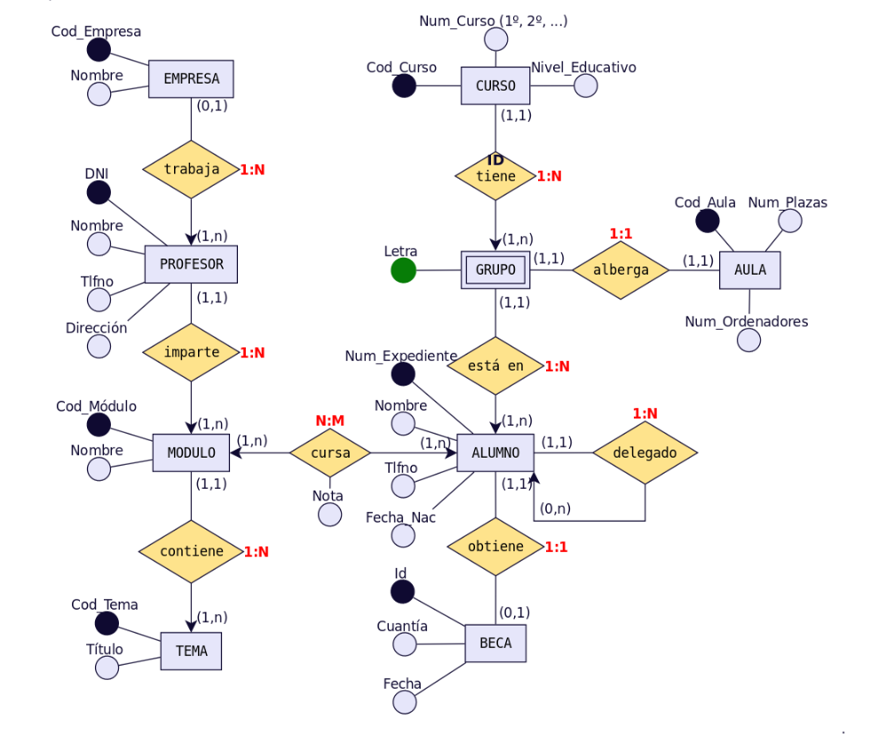
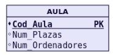
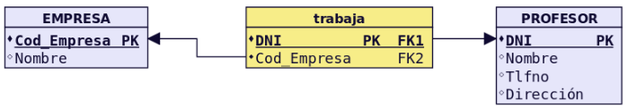
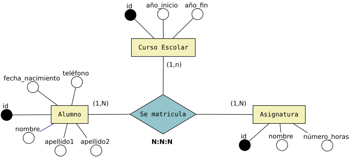
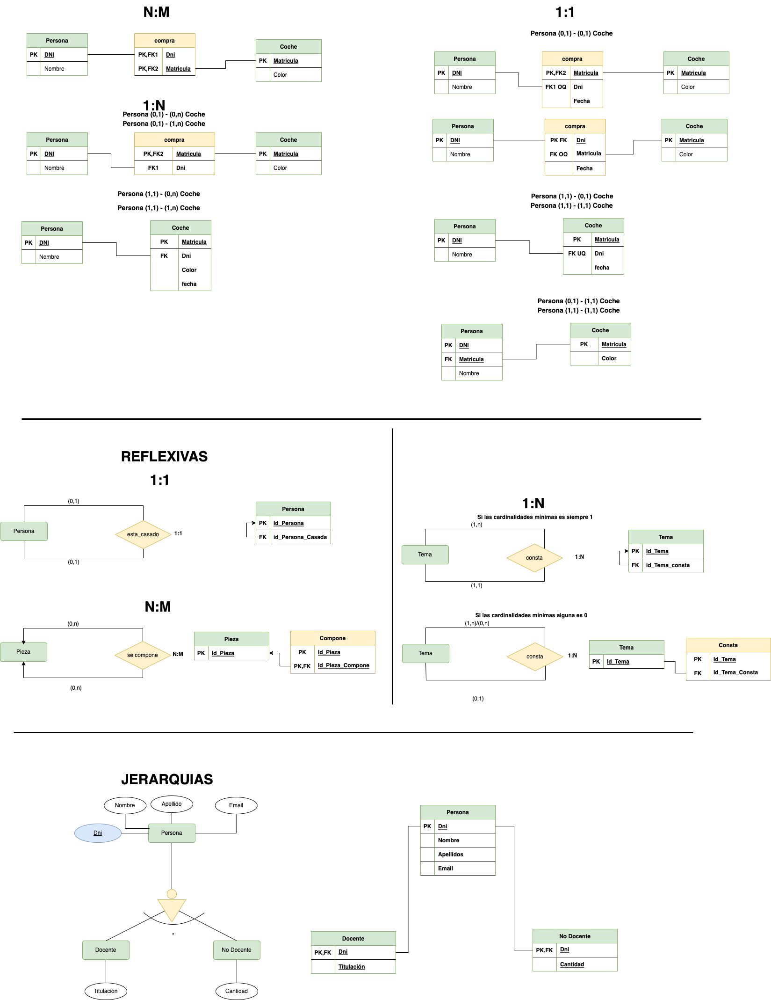

# Tema 3. El modelo relacional

> **Módulo:** Bases de Datos (BAE) · **Curso:** 1.º DAM  
> **De los diagramas entidad–relación a las tablas de una base de datos**

## Objetivos de aprendizaje

En el tema anterior aprendimos a representar la información mediante **entidades, atributos y relaciones** en un diagrama E/R. Ahora vamos a convertir ese dibujo en **tablas relacionadas entre sí**, que después podremos crear con SQL.

Al finalizar este tema serás capaz de:

1. Reconocer tablas, filas, columnas y dominios.
2. Distinguir las claves primarias (PK), candidatas, alternativas y foráneas (FK).
3. Transformar entidades y relaciones **1:N, N:M y 1:1** en tablas.
4. Resolver casos especiales: atributos multivaluados, entidades débiles, relaciones reflexivas, ternarias y jerarquías.
5. Comprobar si las tablas representan correctamente las reglas del problema.
6. Entender las operaciones más habituales del álgebra relacional, incluido el producto cartesiano.

---

## 1. ¿Qué es el modelo relacional?

Una base de datos sirve para guardar información de forma organizada. El **modelo relacional** es una manera de organizarla en **tablas** que se pueden conectar mediante claves.

Por ejemplo, un centro educativo necesita guardar información sobre sus alumnos y módulos. Podemos utilizar dos tablas:

**ALUMNO**

| id_alumno | nombre | municipio |
|---:|---|---|
| 1 | Ana | Güímar |
| 2 | Pablo | La Laguna |
| 3 | Lucía | Güímar |

**MODULO**

| id_modulo | nombre |
|---:|---|
| 10 | Bases de Datos |
| 20 | Lenguajes de Marcas |

Cada tabla almacena un tipo de información. Más adelante veremos cómo relacionarlas para saber, por ejemplo, **en qué módulos está matriculado cada alumno**.

### 1.1. Del modelo E/R al modelo relacional

Recuerda la diferencia:

| Modelo E/R (conceptual) | Modelo relacional (lógico) |
|---|---|
| Representamos **entidades** con rectángulos. | Representamos la información mediante **tablas**. |
| Indicamos **atributos**. | Esos datos se convierten en **columnas**. |
| Dibujamos **relaciones** y cardinalidades. | Establecemos conexiones mediante **claves foráneas** o tablas intermedias. |

**Idea principal:** el modelo E/R explica *qué información existe y cómo se relaciona*; el modelo relacional explica *en qué tablas y columnas la vamos a organizar*.



*Figura 1. Ejemplo de un diagrama E/R con varias entidades y relaciones. Lo estudiaremos por partes.*

---

## 2. Elementos de una tabla

Vamos a utilizar esta tabla:

**PERSONA**

| dni | nombre | apellido | fecha_nacimiento |
|---|---|---|---|
| 52768987 | Juan | Loza | 15/06/1976 |
| 06876983 | Isabel | Gálvez | 23/12/1969 |
| 34678987 | Micaela | Ruiz | 02/10/1985 |

| Concepto | Significado | Ejemplo |
|---|---|---|
| **Tabla o relación** | Conjunto de datos relacionados. | `PERSONA` |
| **Atributo o campo** | Una columna: describe una característica. | `nombre` |
| **Tupla o registro** | Una fila: representa un elemento concreto. | La fila de Juan |
| **Dominio** | Valores permitidos en una columna. | `fecha_nacimiento` debe contener fechas válidas. |
| **Grado** | Número de columnas de una tabla. | 4 |
| **Cardinalidad de la tabla** | Número de filas que contiene. | 3 |

> **Importante:** la cardinalidad de una **tabla** (número de filas) no es lo mismo que la cardinalidad **1:N** de una relación del modelo E/R.

### 2.1. Estructura frente a datos

La **estructura** indica qué columnas tiene la tabla:

```text
PERSONA(dni, nombre, apellido, fecha_nacimiento)
```

Los **datos** son sus filas (Juan, Isabel, Micaela...). La estructura puede permanecer igual mientras añadimos o eliminamos personas.

En teoría, una relación es un conjunto de tuplas sobre unos atributos. A nivel introductorio usaremos habitualmente «tabla» para representarla. Conviene recordar que SQL puede producir resultados con filas duplicadas, mientras que una relación matemática no contiene tuplas duplicadas.

### 2.2. Propiedades básicas

- Cada tabla tiene un nombre diferente dentro del esquema.
- No podemos repetir el nombre de una columna dentro de la misma tabla.
- Cada columna debe admitir valores adecuados a su dominio (por ejemplo, una edad no debería almacenar «azul»).
- Una celda representa **un valor**, no una lista de valores.
- En el modelo relacional, el orden de las filas no tiene significado.
- Los registros deben poder identificarse sin ambigüedad.

**¿Y `NULL`?** Significa que no hay un valor registrado. No es lo mismo que `0` ni que una cadena vacía (`''`). Una columna puede admitirlo o prohibirlo según las reglas de la base de datos.

**Comprueba:** en la tabla PERSONA, ¿cuál es el grado? ¿Y la cardinalidad? ¿Cuál de los campos podría servir para identificar a cada persona?

---

## 3. Las claves: cómo identificamos y conectamos los datos

Una **clave** es uno o varios atributos que sirven para identificar registros o relacionar tablas.

### 3.1. Clave primaria (PK)

La **Primary Key** identifica de forma única cada fila de una tabla.

**ALUMNO**

| id_alumno **PK** | nombre |
|---:|---|
| 1 | Ana |
| 2 | Pablo |
| 3 | Lucía |

Reglas:

- No se puede repetir.
- No puede ser `NULL`.
- Puede estar formada por **una columna o varias**.

Aquí elegimos `id_alumno`, porque dos alumnos podrían llamarse igual.

### 3.2. Clave candidata y clave alternativa

Imagina que cada alumno tiene un identificador interno y un número de expediente, ambos únicos.

- **Clave candidata:** cualquiera de los identificadores mínimos que podrían actuar como PK (`id_alumno`, `num_expediente`).
- **Clave primaria:** la candidata que elegimos (`id_alumno`).
- **Clave alternativa:** otra candidata que no elegimos (`num_expediente`), pero que debe seguir siendo única.

Una candidata también puede tener **varias columnas**. No es necesariamente un solo atributo.

### 3.3. Clave foránea (FK)

La **Foreign Key** permite relacionar una tabla con otra. Sus valores deben hacer referencia a registros existentes de la tabla de destino (salvo que se permita `NULL`).

**PROFESOR**

| id_profesor **PK** | nombre |
|---:|---|
| 1 | Marta |
| 2 | Carlos |

**ALUMNO**

| id_alumno **PK** | nombre | id_profesor **FK** |
|---:|---|---:|
| 101 | Ana | 1 |
| 102 | Pablo | 1 |
| 103 | Lucía | 2 |

Así sabemos que Ana y Pablo tienen a Marta como profesora, y Lucía tiene a Carlos.

`ALUMNO.id_profesor` apunta a `PROFESOR.id_profesor`.

- Podemos repetir el valor `1` en la FK: **una profesora puede tener varios alumnos**.
- No podemos poner `99` si no existe un profesor con identificador `99`.
- Si se permite un alumno sin profesor asignado, la FK podría ser `NULL`.

### 3.4. Clave primaria compuesta

A veces **una sola columna no basta** para distinguir registros. Por ejemplo:

**MATRICULA**

| id_alumno **PK, FK** | id_modulo **PK, FK** | fecha_matricula |
|---:|---:|---|
| 1 | 10 | 10/09/2026 |
| 1 | 20 | 10/09/2026 |
| 2 | 10 | 11/09/2026 |

La PK es **la combinación** `(id_alumno, id_modulo)`. No hay dos claves primarias: existe **una única PK formada por dos columnas**.

Esto impide que aparezca dos veces la misma combinación de alumno y módulo. Si el centro permitiera varias matrículas del mismo alumno en el mismo módulo en diferentes cursos, habría que añadir, por ejemplo, `curso_academico` a la clave o establecer otro identificador adecuado.

### 3.5. Tres reglas de integridad que debes conocer

| Regla | Qué impide | Ejemplo |
|---|---|---|
| **Integridad de entidad** | Una PK nula o repetida. | No puede haber dos alumnos con `id_alumno = 1`. |
| **Integridad referencial** | Una FK que apunte a un registro inexistente. | No asignamos el profesor `99` si no existe. |
| **Integridad de dominio** | Valores no válidos para un atributo. | Una nota de 15 en un sistema de 0 a 10. |

---

## 4. Cómo transformar un diagrama E/R en tablas

Vamos a seguir siempre el mismo procedimiento:

1. **Localiza las entidades** del diagrama.
2. **Crea una tabla por cada entidad principal**, con sus atributos y su PK.
3. **Observa la relación** entre las entidades: ¿1:N, N:M o 1:1?
4. **Aplica la regla de transformación** correspondiente.
5. **Comprueba los datos**: ¿podrías registrar casos reales sin duplicaciones ni conexiones incorrectas?

### 4.1. Primera regla: una entidad se convierte en una tabla

Si en E/R aparece:

```text
ENTIDAD: AULA
- cod_aula (identificador)
- num_plazas
- num_ordenadores
```

En el modelo relacional tendremos:

```text
AULA(cod_aula PK, num_plazas, num_ordenadores)
```



*Figura 2. La entidad AULA y su representación como tabla.*

**Hasta aquí solo hemos creado tablas.** Ahora necesitamos conectarlas cuando en el E/R aparezcan relaciones.

---

## 5. Relaciones 1:N (uno a muchos)

### 5.1. ¿Qué significa 1:N?

Un profesor puede tener **muchos alumnos**, pero cada alumno tiene **un profesor tutor** (para este ejemplo).

```text
PROFESOR (1) ───────── (N) ALUMNO
```

### 5.2. Regla principal

> **En una relación 1:N, normalmente copiamos la PK del lado 1 a la tabla del lado N como FK.** No necesitamos una tercera tabla.

**Antes:** dos entidades relacionadas, PROFESOR y ALUMNO.

**Después:**

```text
PROFESOR(id_profesor PK, nombre)
ALUMNO(id_alumno PK, nombre, id_profesor FK -> PROFESOR.id_profesor)
```

Mira los datos del apartado 3.3: la FK `id_profesor` está en ALUMNO porque es el lado **N**. Cada fila de ALUMNO puede indicar qué profesor le corresponde.



*Figura 3. Relación 1:N entre MÓDULO y TEMA. La FK aparece en TEMA.*

### 5.3. ¿Qué ocurre si la relación es opcional?

Puede haber alumnos que todavía no tengan profesor asignado. En ese caso, si las reglas lo permiten:

| id_alumno **PK** | nombre | id_profesor **FK** |
|---:|---|---:|
| 104 | Diego | `NULL` |

**No es obligatorio crear una tabla intermedia solo para evitar `NULL`.** El diseño depende de las reglas y necesidades del problema.

### 5.4. ¿Y si la relación tiene atributos?

Por ejemplo, si cada alumno tiene asignado un único tutor y queremos guardar `fecha_asignacion`, normalmente ese atributo también puede colocarse en ALUMNO junto a la FK.

```text
ALUMNO(id_alumno PK, nombre, id_profesor FK, fecha_asignacion)
```

### 5.5. Otra posibilidad: tabla para la relación

En algunos diseños, una relación 1:N puede representarse mediante una tabla adicional, por ejemplo `TRABAJA`, que conecte `PROFESOR` y `EMPRESA`. **Es una posibilidad de diseño**, pero no significa que toda relación 1:N opcional necesite una tabla intermedia.


*Figura 4. Ejemplo de una relación 1:N representada con una tabla intermedia.*

**Pregunta:** si tenemos 1 departamento y 20 empleados, ¿en qué tabla guardarías `id_departamento`? ¿Por qué?

---

## 6. Relaciones N:M (muchos a muchos)

### 6.1. ¿Qué significa N:M?

Un alumno puede estar matriculado en **muchos módulos** y cada módulo puede tener **muchos alumnos**.

```text
ALUMNO (N) ───────── (M) MODULO
```

### 6.2. Regla principal

> **En una relación N:M creamos una tabla intermedia** con las claves de las dos entidades participantes como FKs.

**Paso 1.** Tenemos nuestras tablas:

```text
ALUMNO(id_alumno PK, nombre)
MODULO(id_modulo PK, nombre)
```

**Paso 2.** Creamos `MATRICULA`:

```text
MATRICULA(
    id_alumno PK, FK -> ALUMNO.id_alumno,
    id_modulo PK, FK -> MODULO.id_modulo,
    fecha_matricula
)
```

**Paso 3.** La combinación de ambos identificadores forma **una PK compuesta** si solo se permite una matrícula por alumno y módulo.


*Figura 5. ALUMNO–MÓDULO y tabla CURSA. También se puede utilizar el nombre MATRICULA para representar la inscripción, según el contexto.*

### 6.3. ¿Por qué no basta con una FK en ALUMNO?

Porque tendríamos que guardar varios módulos en un solo campo o repetir datos del alumno. Una tabla intermedia representa cada matrícula **en una fila independiente**.

### 6.4. ¿Dónde van los atributos de la relación?

Si el E/R incluye `fecha_matricula`, `nota` o `convocatoria` como atributos de la matrícula, normalmente se guardan en la **tabla intermedia**.

**Importante:** la PK compuesta por las dos FKs es la solución habitual **cuando esa pareja de valores no puede repetirse**. Si una misma pareja puede aparecer varias veces por convocatoria o curso académico, la clave deberá adaptarse.

**Pregunta:** una película puede tener varios actores y un actor puede participar en varias películas. ¿Cuántas tablas hacen falta y cómo se relacionan?

---

## 7. Relaciones 1:1 (uno a uno)

### 7.1. ¿Qué significa 1:1?

En nuestro ejemplo, cada pasaporte pertenece a **una persona** y cada persona tiene **como máximo un pasaporte vigente**.

```text
PERSONA (1) ───────── (1) PASAPORTE
```

No todas las personas tienen pasaporte. Por eso conviene pensar también si la participación es **obligatoria u opcional**.

### 7.2. Solución frecuente: FK con `UNIQUE`

```text
PERSONA(id_persona PK, nombre)
PASAPORTE(numero_pasaporte PK, id_persona FK UNIQUE, fecha_caducidad)
```

En `PASAPORTE`, `id_persona`:

- es **FK** porque señala a una persona existente;
- es **UNIQUE** porque no queremos dos pasaportes vigentes asociados a la misma persona;
- es **NOT NULL** si todo pasaporte debe pertenecer a una persona.

**¿Por qué ponemos la FK en PASAPORTE?** Porque puede haber personas sin pasaporte, pero no queremos guardar pasaportes sin titular.

### 7.3. ¿Se puede hacer de otra forma?

Sí. Según el problema, puede interesar:

- **Colocar una FK única en una de las tablas.** Es la opción habitual.
- **Fusionar las tablas.** Solo si tiene sentido tratar ambos conceptos como uno y se cumplen las restricciones.
- **Crear una tabla para la relación.** Puede ser útil cuando hay opcionalidad en ambos lados, atributos propios del vínculo o la necesidad de conservar su historial.

**No hay que memorizar «siempre crear tabla» o «nunca crear tabla» para 1:1.** Lo importante es representar correctamente la relación.


*Figura 6. Relación 1:1 entre ALUMNO y BECA. Cuando una FK representa una relación 1:1, debe garantizarse su unicidad.*


*Figura 7. Una relación 1:1 opcional por ambos lados también puede representarse mediante una tabla intermedia.*

---

## 8. Repaso: las tres transformaciones fundamentales

| Relación E/R | Qué hacemos habitualmente | Ejemplo |
|---|---|---|
| **1:N** | PK del lado 1 → FK en el lado N. | Un departamento tiene muchos empleados. |
| **N:M** | Creamos una tabla intermedia con dos FKs. | Alumnos cursan módulos. |
| **1:1** | Una FK **única** en una tabla; valorar opcionalidad y otras estrategias. | Persona y pasaporte vigente. |

> **Truco:** antes de dibujar la transformación, intenta contar la historia: «uno puede tener muchos…», «muchos pueden tener muchos…» o «uno se relaciona como máximo con uno…».

### Ejercicio resuelto

**Enunciado:** un cliente puede realizar muchos pedidos, pero cada pedido pertenece a un único cliente.

1. Entidades: `CLIENTE` y `PEDIDO`.
2. Relación: **1:N**.
3. El lado N es `PEDIDO`.
4. La PK de CLIENTE se copia a PEDIDO como FK.

```text
CLIENTE(id_cliente PK, nombre)
PEDIDO(id_pedido PK, fecha, id_cliente FK -> CLIENTE.id_cliente)
```

**Comprueba con datos:** si el cliente 5 hace tres pedidos, aparecerán tres filas en PEDIDO con `id_cliente = 5`, sin repetir el nombre del cliente.

---

## 9. Casos especiales (después de dominar 1:N, N:M y 1:1)

### 9.1. Atributos con varios valores

Una persona puede tener **varios teléfonos**. En vez de guardar `600..., 700...` en una misma celda, creamos una tabla específica:

```text
PERSONA(id_persona PK, nombre)
TELEFONO_PERSONA(id_persona PK, FK -> PERSONA.id_persona, telefono PK)
```

La combinación `(id_persona, telefono)` identifica cada teléfono de esa persona.

### 9.2. Entidades débiles

Una entidad débil necesita otra entidad para identificarse correctamente.

**Ejemplo:** la habitación 101 puede existir en varios hoteles. El número de habitación no es suficiente sin el hotel.

```text
HOTEL(id_hotel PK, nombre)
HABITACION(id_hotel PK, FK -> HOTEL.id_hotel, numero PK, capacidad)
```

La PK de HABITACION es `(id_hotel, numero)`.

### 9.3. Relaciones reflexivas (una entidad se relaciona consigo misma)

**Ejemplo 1:N:** un empleado puede supervisar a varios empleados. Un empleado puede tener un supervisor.

```text
EMPLEADO(
    id_empleado PK,
    nombre,
    id_supervisor FK -> EMPLEADO.id_empleado
)
```

La FK apunta **a la misma tabla** y puede ser `NULL` para quien no tenga supervisor.


*Figura 8. En ALUMNO, una clave aparece de nuevo como FK para representar quién es el delegado.*

En una reflexiva **N:M**, como módulos que requieren varios prerrequisitos y pueden ser prerrequisito de otros, normalmente creamos una tabla intermedia con dos FKs a `MODULO`.

### 9.4. Relaciones de tres entidades (ternarias)

Una relación ternaria conecta **tres entidades a la vez**.

**Ejemplo:** un proveedor suministra un producto para un proyecto a un precio concreto. El precio depende de la combinación completa.

```text
SUMINISTRO(
    id_proveedor FK -> PROVEEDOR.id_proveedor,
    id_producto FK -> PRODUCTO.id_producto,
    id_proyecto FK -> PROYECTO.id_proyecto,
    precio
)
```

En una relación **N:N:N** donde cada combinación de los tres identificadores debe ser única, esos tres campos pueden formar una PK compuesta.

**Cuidado:** no debemos dividir automáticamente una ternaria en tres relaciones binarias: podríamos perder qué proveedor entregó qué producto **para qué proyecto**. La elección de la PK también depende de las cardinalidades y las reglas de negocio.


*Figura 9. Relación ternaria entre ALUMNO, CURSO ESCOLAR y ASIGNATURA.*

### 9.5. Jerarquías: supertipo y subtipos

Una jerarquía aparece cuando varias entidades comparten características.

**Ejemplo:** ALUMNO y DOCENTE son tipos de PERSONA.

Una transformación clara es conservar una tabla para el tipo general y otra por subtipo:

```text
PERSONA(id_persona PK, nombre, correo)
ALUMNO(id_persona PK, FK -> PERSONA.id_persona, num_expediente)
DOCENTE(id_persona PK, FK -> PERSONA.id_persona, especialidad)
```

Así no repetimos `nombre` y `correo` en cada subtipo.

También existen diseños con **una única tabla** y diseños con **una tabla por subtipo**. La elección depende de si los subtipos son exclusivos o pueden solaparse, de si todas las personas pertenecen a alguno y de los datos que queramos guardar.



*Figura 10. Ejemplo de jerarquía formada por una entidad general y sus subtipos.*

---

## 10. Introducción sencilla al álgebra relacional

El álgebra relacional reúne operaciones para **obtener información a partir de tablas**. No es necesario dominar todavía su notación para entender qué hace cada operación.

Partimos de:

**ALUMNO**

| id | nombre | municipio |
|---:|---|---|
| 1 | Ana | Güímar |
| 2 | Pablo | La Laguna |
| 3 | Lucía | Güímar |

### 10.1. Selección (σ): elegir filas

**Pregunta:** ¿qué alumnos viven en Güímar?

```text
σ municipio='Güímar' (ALUMNO)
```

Resultado: Ana y Lucía, con todas sus columnas.

**Recuerda:** selección = **filtrar filas**.

### 10.2. Proyección (π): elegir columnas

**Pregunta:** ¿qué nombres tenemos guardados?

```text
π nombre (ALUMNO)
```

Resultado: una columna con Ana, Pablo y Lucía. En el álgebra relacional clásica se eliminan las filas repetidas del resultado.

**Recuerda:** proyección = **elegir columnas**.

### 10.3. Producto cartesiano (×): todas las combinaciones

Supongamos que tenemos 3 alumnos y 2 módulos:

**MODULO**

| id_modulo | nombre |
|---:|---|
| 10 | BAE |
| 20 | LND |

El producto cartesiano `ALUMNO × MODULO` combina **cada alumno con cada módulo**, aunque el alumno no esté matriculado en él.

| Alumno | Módulo |
|---|---|
| Ana | BAE |
| Ana | LND |
| Pablo | BAE |
| Pablo | LND |
| Lucía | BAE |
| Lucía | LND |

**Número de filas: 3 × 2 = 6.** Es importante: el producto cartesiano **no comprueba si existe una relación real** entre los registros.

### 10.4. Combinación (JOIN): relacionar filas

Un `JOIN` combina filas que cumplen una condición, por ejemplo, que el identificador del alumno coincida con el de la tabla MATRICULA.

Esto nos permite responder: «¿qué módulos cursa Ana?», sin generar todas las parejas posibles como resultado final.

### 10.5. Otras operaciones: unión, intersección y diferencia

Si tenemos dos conjuntos de identificadores de alumnos:

- **Unión (∪):** alumnos que están en uno, en otro o en ambos.
- **Intersección (∩):** alumnos que aparecen en ambos.
- **Diferencia (−):** alumnos que aparecen en el primero, pero no en el segundo.

Para estas operaciones, las relaciones deben tener **estructuras compatibles** (mismo número de atributos y dominios correspondientes compatibles).

> También existen operadores como renombrado y división. La división sirve para preguntas del tipo «¿qué alumnos cursan **todos** los módulos de un conjunto?». Los trabajaremos con mayor profundidad cuando sea necesario.

---

## 11. Ejemplo completo resuelto: una academia

**Enunciado:**

- Una academia tiene varios profesores.
- Cada profesor puede impartir varios módulos; cada módulo tiene un profesor responsable (simplificación del ejemplo).
- Cada alumno puede matricularse en varios módulos.
- Un módulo puede tener muchos alumnos.
- En cada matrícula guardamos la fecha de inscripción.

### Paso 1. Identificar las entidades

`PROFESOR`, `MODULO` y `ALUMNO`.

### Paso 2. Identificar las relaciones

- PROFESOR–MODULO: **1:N**.
- ALUMNO–MODULO: **N:M**.

### Paso 3. Transformar

```text
PROFESOR(
    id_profesor PK,
    nombre
)

MODULO(
    id_modulo PK,
    nombre,
    id_profesor FK -> PROFESOR.id_profesor
)

ALUMNO(
    id_alumno PK,
    nombre
)

MATRICULA(
    id_alumno PK, FK -> ALUMNO.id_alumno,
    id_modulo PK, FK -> MODULO.id_modulo,
    fecha_matricula
)
```

### Paso 4. Comprobar con datos

**PROFESOR**

| id_profesor | nombre |
|---:|---|
| 1 | Marta |
| 2 | Carlos |

**MODULO**

| id_modulo | nombre | id_profesor |
|---:|---|---:|
| 10 | BAE | 1 |
| 20 | LND | 1 |
| 30 | Programación | 2 |

**ALUMNO**

| id_alumno | nombre |
|---:|---|
| 101 | Ana |
| 102 | Pablo |

**MATRICULA**

| id_alumno | id_modulo | fecha_matricula |
|---:|---:|---|
| 101 | 10 | 10/09/2026 |
| 101 | 20 | 10/09/2026 |
| 102 | 10 | 11/09/2026 |

Ahora podemos contestar:

- ¿Quién imparte LND? **Marta** (`MODULO.id_profesor = 1`).
- ¿Qué módulos cursa Ana? **BAE y LND** (dos filas en MATRICULA con `id_alumno = 101`).
- ¿Cuántas veces repetimos el nombre de Ana en MATRICULA? **Ninguna**: solo repetimos su identificador.

---

## 12. Errores frecuentes

| Error | Corrección |
|---|---|
| «En 1:N la FK va en el lado 1». | Normalmente, **va en el lado N**. |
| «En N:M basta con una FK». | Normalmente hace falta **una tabla intermedia**. |
| «La tabla intermedia tiene dos PK». | Tiene **una PK compuesta**, si ambas FKs forman su identificador. |
| «Una FK nunca puede ser NULL». | Puede admitir `NULL` si el vínculo es opcional y el diseño lo permite. |
| «Una FK garantiza por sí sola una relación 1:1». | También hay que impedir referencias repetidas, normalmente con `UNIQUE`. |
| «Una relación ternaria siempre puede dividirse en binarias». | No necesariamente: podríamos **perder información**. |
| «El producto cartesiano muestra solo las parejas relacionadas». | Muestra **todas las combinaciones**. |
| «El orden de las filas de una tabla siempre está garantizado». | No: si queremos orden en una consulta SQL necesitaremos especificarlo. |

---

## 13. Actividades para practicar

**Actividad 1.** En una tabla PRODUCTO con 5 columnas y 20 registros, indica su grado y su cardinalidad.

**Actividad 2.** Explica con tus palabras la diferencia entre PK y FK. Pon un ejemplo de cada una.

**Actividad 3.** Un departamento puede tener muchos empleados y cada empleado pertenece a un departamento. Indica la cardinalidad y escribe las dos tablas con PK y FK.

**Actividad 4.** Un estudiante puede asistir a varios talleres y un taller puede recibir varios estudiantes. Diseña las tablas necesarias e incluye `fecha_inscripcion`.

**Actividad 5.** Una persona puede tener como máximo una tarjeta de acceso activa. Cada tarjeta pertenece a una persona. Propón un diseño 1:1 que impida repetir el titular.

**Actividad 6.** Explica por qué esta tabla puede ser problemática:

| id_alumno | nombre | telefonos |
|---:|---|---|
| 1 | Ana | 600111222, 600333444 |

Propón una transformación.

**Actividad 7.** En una empresa, cada empleado puede tener un supervisor que también es empleado. Diseña una tabla para este caso.

**Actividad 8.** Tenemos 8 alumnos y 4 módulos. ¿Cuántas filas produce su producto cartesiano? ¿Significa eso que existen 32 matrículas reales?

**Actividad 9.** Dibuja un diagrama E/R con CLIENTE, PEDIDO y PRODUCTO para representar que un cliente hace pedidos y un pedido puede incluir varios productos. Transfórmalo en tablas y explica qué reglas has usado. Puedes suponer que un producto aparece como máximo una vez por pedido.

**Actividad 10.** Revisa el ejemplo de la academia del apartado 11. ¿Qué cambiarías si cada módulo pudiera tener **varios profesores** en vez de uno solo?

---

## 14. Resumen para estudiar

**Conceptos:**

- **Tabla:** conjunto de registros sobre un mismo tema.
- **Fila o tupla:** un registro.
- **Columna o atributo:** una característica.
- **Dominio:** valores que admite un atributo.
- **PK:** identifica una fila sin repetirse y sin `NULL`.
- **FK:** enlaza un registro con otro y debe cumplir la integridad referencial.

**Transformaciones:**

```text
ENTIDAD        → Tabla con sus atributos y su PK
1:N            → PK del lado 1 pasa como FK al lado N
N:M            → Tabla intermedia con las FKs de ambas entidades
1:1            → Habitualmente, una FK única en una de las tablas
REFLEXIVA 1:N  → FK que apunta a la misma tabla
TERNARIA N:N:N → Tabla que reúne las tres FKs; PK según las reglas
JERARQUÍA      → Elegir una estrategia para supertipo y subtipos
```



*Figura 11. Esquemas de apoyo para repasar las transformaciones. Recuerda que los casos opcionales pueden tener distintas soluciones válidas según los requisitos.*

---
