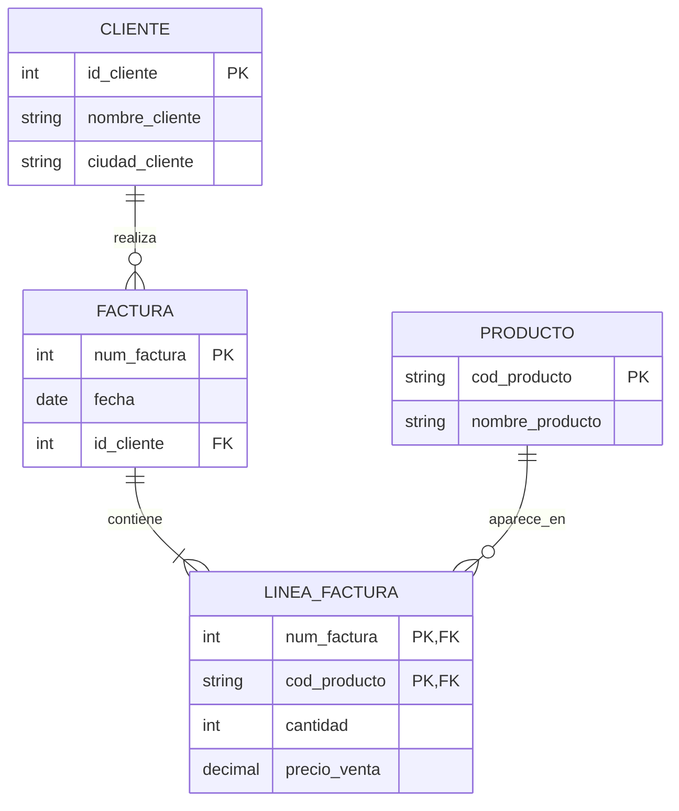

# 4. Ejemplo completo: facturas

Vamos a normalizar una tabla de ventas hasta 3FN.

## 4.1. Situación inicial

Una empresa guarda una fila por cada producto incluido en una factura:

### `VENTA_INICIAL`

| num_factura | fecha | id_cliente | nombre_cliente | ciudad_cliente | cod_producto | nombre_producto | cantidad | precio_venta |
| ---: | --- | ---: | --- | --- | --- | --- | ---: | ---: |
| 1001 | 2026-09-10 | 7 | Ana Pérez | La Orotava | P10 | Teclado | 2 | 24.90 |
| 1001 | 2026-09-10 | 7 | Ana Pérez | La Orotava | P20 | Ratón | 1 | 12.50 |
| 1002 | 2026-09-11 | 9 | Luis Díaz | Puerto de la Cruz | P10 | Teclado | 1 | 23.90 |

Supongamos estas reglas:

- cada factura pertenece a un único cliente;
- cada cliente tiene un identificador y unos datos propios;
- cada código identifica un único producto;
- un producto aparece como máximo una vez en cada factura;
- el precio de venta queda registrado en la línea porque puede variar entre facturas.

## 4.2. Clave y dependencias

Cada fila representa un producto dentro de una factura. La clave candidata es:

```text
(num_factura, cod_producto)
```

Dependencias funcionales:

```text
num_factura → fecha, id_cliente
id_cliente → nombre_cliente, ciudad_cliente
cod_producto → nombre_producto
(num_factura, cod_producto) → cantidad, precio_venta
```

Observa que `precio_venta` depende de la línea completa. El precio cobrado puede ser distinto del precio actual del catálogo.

## 4.3. Primera forma normal

Todos los valores son atómicos y no hay listas en las celdas. La relación está en 1FN.

Esto no significa que el diseño sea correcto: siguen existiendo datos repetidos.

## 4.4. Segunda forma normal

La clave es compuesta y existen dependencias parciales:

```text
num_factura → fecha, id_cliente
cod_producto → nombre_producto
```

Separamos los datos que dependen de cada parte de la clave:

```text
FACTURA_TEMP(
  num_factura PK,
  fecha,
  id_cliente,
  nombre_cliente,
  ciudad_cliente
)

PRODUCTO(
  cod_producto PK,
  nombre_producto
)

LINEA_FACTURA(
  num_factura PK FK → FACTURA_TEMP,
  cod_producto PK FK → PRODUCTO,
  cantidad,
  precio_venta
)
```

`LINEA_FACTURA` conserva los atributos que dependen de la clave completa.

## 4.5. Tercera forma normal

En `FACTURA_TEMP` aparece una dependencia transitiva:

```text
num_factura → id_cliente → nombre_cliente, ciudad_cliente
```

Los datos personales describen al cliente, no a la factura. Creamos una relación independiente:

```text
CLIENTE(
  id_cliente PK,
  nombre_cliente,
  ciudad_cliente
)

FACTURA(
  num_factura PK,
  fecha,
  id_cliente FK → CLIENTE
)
```

## 4.6. Esquema final en 3FN

```text
CLIENTE(
  id_cliente PK,
  nombre_cliente,
  ciudad_cliente
)

FACTURA(
  num_factura PK,
  fecha,
  id_cliente FK → CLIENTE
)

PRODUCTO(
  cod_producto PK,
  nombre_producto
)

LINEA_FACTURA(
  num_factura PK FK → FACTURA,
  cod_producto PK FK → PRODUCTO,
  cantidad,
  precio_venta
)
```

## 4.7. Representación del resultado



## 4.8. ¿Qué hemos conseguido?

- Cambiar el nombre de un cliente requiere una única actualización.
- Podemos crear un producto aunque todavía no se haya vendido.
- Eliminar la última línea de una factura no borra el producto del catálogo.
- Se conserva el precio realmente aplicado en cada venta.
- Las claves ajenas mantienen las relaciones entre los datos.

## 4.9. Decisiones que dependen del negocio

Si un producto pudiera repetirse varias veces en una misma factura, `(num_factura, cod_producto)` ya no sería suficiente. Podríamos utilizar:

```text
(num_factura, num_linea)
```

y mantener `cod_producto` como clave ajena.

La normalización no sustituye al análisis: las reglas del sistema determinan las claves y las dependencias.
